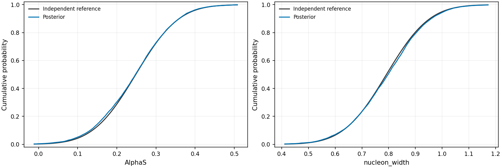
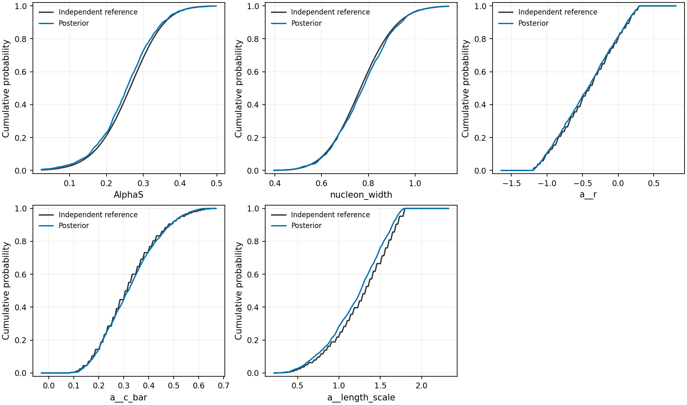

# Model discrepancy

A zero-mean Gaussian discrepancy is marginalized into the observable covariance:

\[
C(\theta,\eta)=C_{\rm experiment}+C_{\rm emulator}(\theta)+K_\eta,
\qquad
\log L=-\tfrac12\{r^T C^{-1}r+\log|C|\}+\mathrm{constant}.
\]

The log determinant is retained when covariance hyperparameters are inferred.
The implementation supports

\[
K^{(1)}_{ij}=s^2+\bar c^2(x_i x_j)^r
\exp[-(x_i-x_j)^2/(2\ell^2)],
\quad
K^{(2)}_{ij}=\bar c^2(x_i x_j)^r
\exp[-(x_i-x_j)^2/(2\ell^2)].
\]

Each emulator group has its own discrepancy settings and physical coordinate
axis. All observables within a group are correlated through that axis; separate
groups have independent discrepancy blocks. Deciding which observables can
share an axis is part of the scientific model.

## Configuration

Add a `discrepancy` block under an emulator group in
`analyses.<analysis>.parameters.emulators`:

```yaml
discrepancy:
  enabled: true
  kernel_type: kernel1
  infer_hyperparameters: false
  parameter_names: [s, r, c_bar, length_scale]
  fixed_params: [0.07, -0.5, 0.3, 0.7]
```

Values follow the declared names. Without names, fixed values retain the legacy
order `[c_bar, length_scale, r, s]`. Inferred parameters are declared with their
bounds and optional independent priors:

```yaml
discrepancy:
  enabled: true
  kernel_type: kernel2
  infer_hyperparameters: true
  parameter_names: [r, c_bar, length_scale]
  min: [-1.2, 0.08, 0.2]
  max: [0.3, 0.65, 1.8]
  prior:
    type: [uniform, gaussian, uniform]
    mean: [null, 0.3, null]
    std: [null, 0.18, null]
```

Kernel1 accepts an optional `s`; it defaults to zero when omitted. Kernel2 has no
inferred `s`. Positive finite bin centers and length scales are required;
amplitudes are nonnegative. Inferred bounds must have finite ordered endpoints
and a positive length-scale floor. Invalid parameters or mapped blocks raise an
error rather than silently removing uncertainty. Repeated coordinates and zero
fixed amplitudes can produce a valid semidefinite discrepancy kernel; the
complete likelihood covariance must be positive definite.

Sampled names are group-qualified, such as `a__length_scale`. Their order is
preserved in HDF5. Model parameters are separated from discrepancy parameters
before emulator evaluation, and fixed model values are restored.

## Repeat the examples

Follow the [common setup](README.md) and run these native recipes:

- [discrepancy_fixed.yaml](../../config/examples/discrepancy_fixed.yaml): emcee,
  fixed kernel1 in group A and fixed kernel2 in group B.
- [discrepancy_inferred.yaml](../../config/examples/discrepancy_inferred.yaml):
  pocoMC, three inferred kernel2 hyperparameters in group A and fixed kernel2
  in group B.

Both use twelve synthetic measurements with interleaved observable groups,
Gaussian model-parameter priors, and a third model parameter fixed to 14.
The emulator is a known linear function of the sampled parameters. The verifier
uses independent dense linear algebra and kernel formulas. Fixed covariance has
an analytic Gaussian posterior; inferred covariance is checked using a
35-by-35-by-35 midpoint grid and analytic conditional Gaussian model posteriors.





The exponent and length scale can remain weakly constrained in one synthetic
realization. Agreement with the reference is the correctness check; exact
recovery of each generating value is not expected. This is not a repeated-data
coverage study.

`plot.discrepancy: true` writes `discrepancy_kernels.h5` and PDF uncertainty plots.
The saved kernel slices are local to each group; insertion into the likelihood
uses the global observable mapping. Posterior kernel draws respect pocoMC
weights, and the displayed MAP kernel uses the highest-target saved sample.

## Corresponding tests

```bash
python -m pytest tests/test_model_discrepancy.py tests/test_discrepancy_samplers.py \
  tests/test_discrepancy_plots.py -q
```

These cover elementwise kernel references, semidefiniteness, interleaved blocks,
name permutations, invalid settings, covariance normalization, both samplers,
and the actual saved-kernel plotting path. Implementation:
[model_discrepancy.py](../../src/bayesian/model_discrepancy.py).
