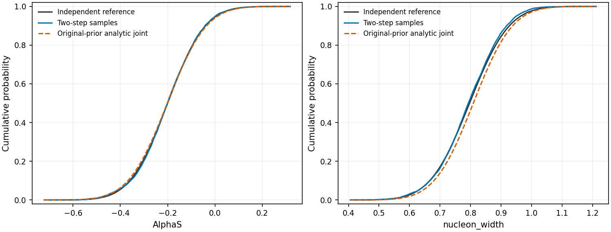
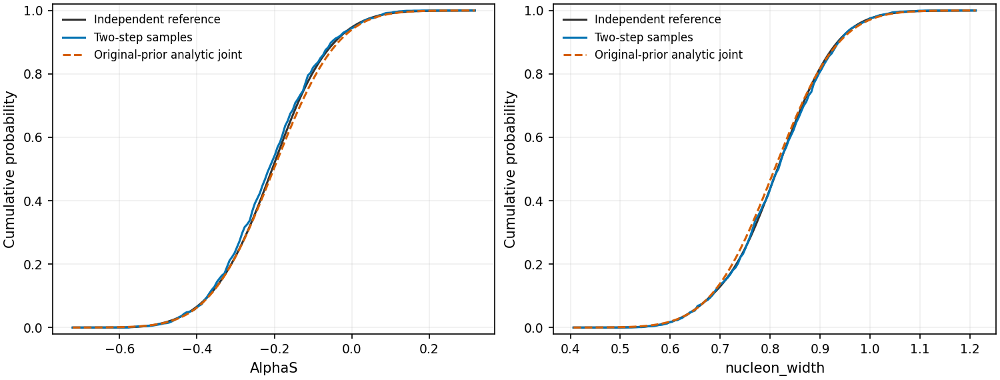

# Two-dataset posterior-to-prior inference

For conditionally independent datasets and a common prior,

\[
p(\theta\mid A,B)\propto L_B(\theta)\,p(\theta\mid A).
\]

This workflow reads the first analysis's existing `posterior.h5`, fits a
Gaussian or weighted KDE in named model coordinates, and uses that fit as the
second analysis's prior. The [projected-soft sequential feature](sequential-inference.md)
loads a separately prepared KDE/flow artifact; its operational configuration is
documented separately.

## Configuration

The first and second analyses are normal entries under `analyses`. Add:

```yaml
inference_workflows:
  two_step:
    type: multistep
    steps: [first, second]
    prior_sources:
      second:
        posterior_file: posterior.h5
        method: gaussian
    run_mcmc: true
    verify_prior_vs_posterior: true
    run_closure_tests: false
```

Only two distinct analysis names are supported. Standard analyses produce the
first posterior before the workflow runs. Relative source paths are anchored
to `<output_dir>/first_<parameterization>/`; absolute paths are also supported.
The legacy singular `prior_source` spelling remains accepted. The plural block
shown above is the recommended form.

Source columns are matched and reordered by `parameter_names`; unused source
columns are marginalized before fitting. Weights must be finite and nonnegative
with positive support. By default the source covers every sampled model
parameter in stage B. An explicit `parameter_names` list selects a subset,
with independent manual priors retained for the remainder. Covered coordinates
use the source density once, including the first-stage prior already present in
that posterior.

Shared model parameters must retain the same fixed value and fixed/sampled
status across stages. Changing these generally requires a conditional posterior.
Second-stage discrepancy parameters retain independent priors in the current
workflow. These examples do not validate transferring a shared discrepancy
posterior across datasets.

The workflow reuses stage B's emulator and observations, and writes new outputs
under `two_step_first_second/`. Multiple parameterizations receive separate
subdirectories. The original analysis definitions are not modified in place.

## Repeat the examples

Follow the [common setup and commands](README.md) with:

- [multistep_gaussian.yaml](../../config/examples/multistep_gaussian.yaml): emcee
  and a fitted Gaussian first-stage posterior.
- [multistep_kde.yaml](../../config/examples/multistep_kde.yaml): pocoMC and a
  weighted KDE first-stage posterior.

The driver runs dataset A, dataset B alone, a standard analysis containing both
datasets, and then the two-step workflow. The standard combined-data analysis
is the joint comparator. The unfinished `inference_workflows.type: joint`
dispatcher is not used or advertised as a supported recipe.





The verifier analytically updates the fitted Gaussian or every Gaussian KDE
kernel using dataset B. That exact fitted-prior reference checks sampler
correctness. The original-prior analytic joint posterior is shown separately:
finite first-stage samples and density smoothing can make the two references
differ. The additional joint sampler is checked against its analytic posterior.

`verify_prior_vs_posterior` writes weighted source histograms and actual fitted
marginals, preserving the joint KDE bandwidth. The optional conditional closure
runs reuse the observed first-stage posterior while substituting second-stage
pseudodata. Full two-dataset coverage requires simulating and refitting both
stages for each experiment.

The old hard-likelihood CSV schema assumes factorized soft and coupling priors.
Set `export_hard_likelihood_samples: false` for a general correlated
`prior_source`; the configuration is checked before sampling. The HDF5 density
components remain available.

## Corresponding tests

```bash
python -m pytest tests/test_posterior_priors.py tests/test_multistep_workflow.py -q
```

Tests cover weighted inputs, reordered and extra source columns, fixed values,
independent remainder priors, stable KDE tails, one-dimensional Gaussian fits,
source paths, output isolation, and both sampler backends. The public YAML
recipes add a complete native-driver handoff check.
