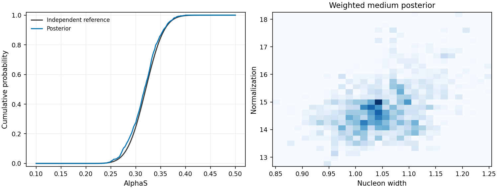
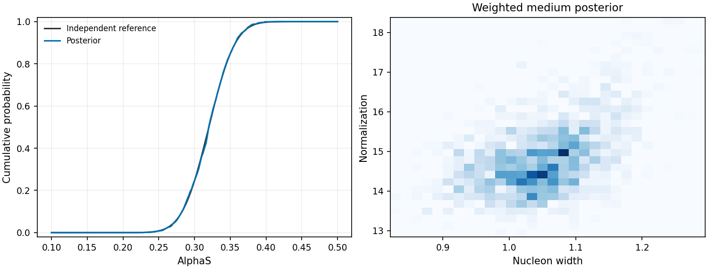

# Projected-soft sequential inference

The projected soft posterior supplies a joint prior for medium parameters
`phi=(nucleon_width, normalization)`. The hard emulator is then evaluated with
that prior and the remaining parameter priors:

\[
p(\alpha_s,\phi\mid D_H,D_S)\propto
L_H(\alpha_s,\phi)^\beta\,p(\phi\mid D_S)\,p_0(\alpha_s).
\]

This construction assumes the stated conditional independence of the datasets
and the intended prior factorization. The soft posterior replaces the original
prior on its covered coordinates; it is counted once. Additional manually
specified parameters retain their priors.

## Configuration and inputs

The settings live under `analyses.<analysis>.parameters.mcmc`:

```yaml
sequential_inference:
  enabled: true
  soft_density_model_file: ../../data/sequential_priors/projected_soft_kde_2d/kde_soft_posterior_2d.pkl
  soft_parameter_names: [nucleon_width, normalization]
  alpha_parameter_name: AlphaS
  hard_likelihood_power: 1.0
```

`soft_density_model_type` can be specified as `gaussian_kde` or
`torch_realnvp_2d`; it is inferred from the artifact suffix when omitted.
Relative artifact paths resolve against the YAML file's directory. The
[preparation command](README.md) resolves them before writing a relocated config.

The versioned artifact payload contains the fitted density, transform metadata,
parameter names, and physical prior box. The loader checks that this metadata
matches the configured names and bounds. The two examples use width `[0.5,1.5]`
and normalization `[10,20]`. KDE and flow evaluation includes the physical-space
transform Jacobian; invalid or out-of-box points receive negative-infinite
prior density. The flow uses float32 network arithmetic.

Check the versioned inputs and configuration before sampling:

```bash
(cd data/sequential_priors && shasum -a 256 -c SHA256SUMS)
python -m bayesian.check_sequential_inference \
  -c config/examples/sequential_kde.yaml -a demo -p exponential --n-samples 64
```

Serialized artifacts should come from a trusted, identified source. The supplied
hash manifest identifies the copies used by these examples.

## Repeat the examples

Use the [common commands](README.md) with:

- [sequential_kde.yaml](../../config/examples/sequential_kde.yaml): emcee and the
  versioned projected-soft KDE.
- [sequential_flow.yaml](../../config/examples/sequential_flow.yaml): pocoMC and
  the versioned projected-soft flow.

The hard emulator separates a Gaussian coupling measurement from a joint
width/normalization measurement. This provides a known truncated-Gaussian
coupling marginal while exercising the joint soft prior in the other two
coordinates. The verifier checks that marginal and the saved hard-likelihood,
prior, and target components. Independent payload-level KDE and flow tests
provide the additional density-loader checks.





`hard_likelihood_power` supports `[0,1]`: zero samples the bounded prior, one
performs the full update, and intermediate values temper the hard likelihood.
Use a fresh output directory when changing this setting. The helper below
prepares a path of configs and rebases artifact paths:

```bash
python -m bayesian.prepare_tempered_sequential_runs --help
```

Its regression tests cover zero, 0.25, and one, both artifact types, shared YAML
settings, and moved config directories.

## Output and tests

Both samplers save the untempered `log_likelihood_hard`, its powered contribution
`log_likelihood_hard_tempered`, `log_prior_bayesian`, and `log_target`. They obey
`log_target = beta * log_likelihood_hard + log_prior_bayesian`. At beta zero the
hard likelihood is evaluated directly; it is not reconstructed by division.
The resolved sequential metadata is saved in both HDF5 outputs.

```bash
python -m pytest tests/test_soft_density.py tests/test_sequential_inference.py \
  tests/test_sequential_samplers.py tests/test_tempered_generation.py -q
```

KDE and flow artifacts may represent different approximations to a source soft
posterior. Their scientific comparison requires study-specific density fitting
and sensitivity checks. These examples establish backend behavior under the
provided artifacts. Evidence normalization for derived priors is described in
[validation and outputs](validation.md).
