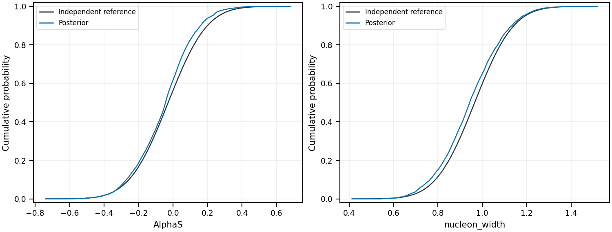
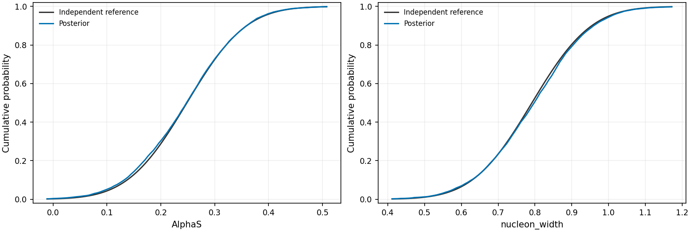
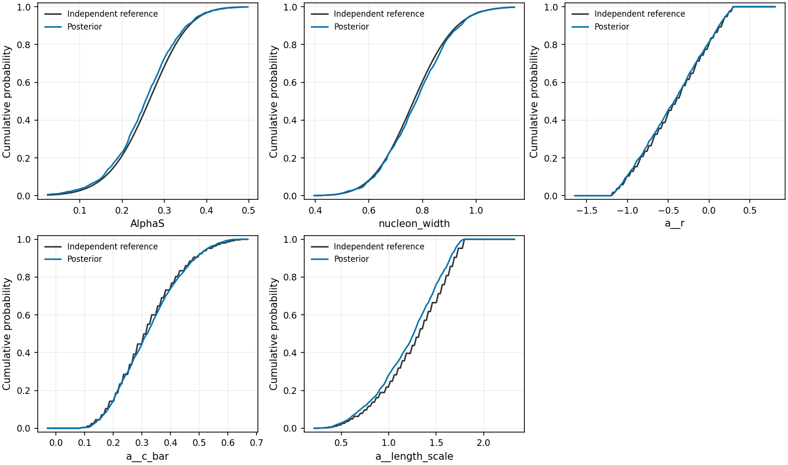
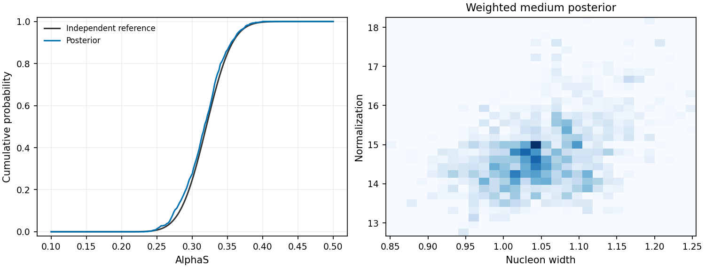
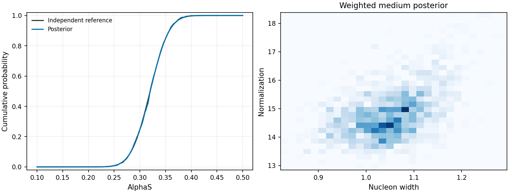
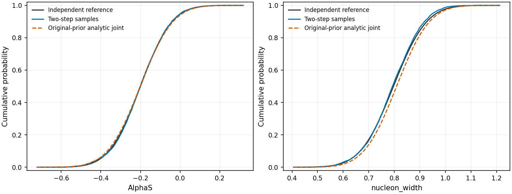
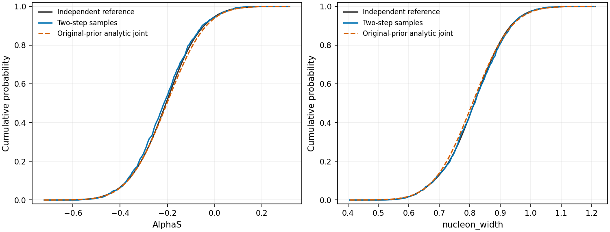

# Bayesian inference guide

The workflow trains GP emulators on model design points, combines measurement
and emulator covariance in a Gaussian likelihood, and samples the posterior.
The runnable examples use exact linear emulators so numerical references are
available without a simulation campaign. Start with `config/examples/baseline.yaml`.

| Method | Prior input / uncertainty | Purpose and runnable YAML |
| --- | --- | --- |
| Plain inference | Declared manual priors | Reference fit: [baseline](../config/examples/baseline.yaml) |
| Model discrepancy | Added covariance kernel | Represent unresolved model error: [fixed](../config/examples/discrepancy_fixed.yaml), [inferred](../config/examples/discrepancy_inferred.yaml) |
| Sequential inference | Projected soft KDE or flow artifact | Update shared parameters: [KDE](../config/examples/sequential_kde.yaml), [flow](../config/examples/sequential_flow.yaml) |
| Multistep inference | First-stage posterior fitted as Gaussian or KDE | Chain two analyses: [Gaussian](../config/examples/multistep_gaussian.yaml), [KDE](../config/examples/multistep_kde.yaml) |

For independent datasets A and B, updating uses
`p(theta | A,B) ∝ L_B(theta) p(theta | A)`; count each dataset once.
Sequential projection additionally assumes the retained coordinates contain the
information needed by the hard update. A marginal cannot supply a missing
conditional distribution. Multistep fitting introduces density-approximation
error. Prefer a joint likelihood when dependencies or discarded coordinates
make these assumptions inappropriate.

Discrepancy represents unresolved model error through an added covariance:
`C_total = C_measurement + C_emulator + K_discrepancy`. Its zero-mean Gaussian
assumption and kernel/prior choices need scientific justification. It can
confound physical parameters; it should not conceal an unvalidated emulator or
an implementation error.

## Contents

- [Setup and examples](#setup-and-examples)
- [Model discrepancy](#model-discrepancy)
- [Sequential inference](#sequential-inference)
- [Multistep inference](#multistep-inference)
- [Validation and outputs](#validation-and-outputs)
- [Versioned inputs](#versioned-inputs)

## Setup and examples

The YAML examples exercise the real driver, samplers and output verifier with
analytic emulators. They require no JETSCAPE simulation run. See
[validation and outputs](#validation-and-outputs) for numerical guarantees and
[native-recipe tests](../tests/test_public_examples.py) for automated checks.

### Environment

Use a source checkout and Python 3.10. The tested requirements are in
[examples/inference/requirements.txt](../examples/inference/requirements.txt).
These demonstrations use the emulator prediction protocol and do not need
GPflow, PyMC, simulation outputs, or a private research checkout. The sequential
examples use the versioned projected-soft artifacts already under `data/`.

```bash
python3.10 -m venv .venv
source .venv/bin/activate
python -m pip install -r examples/inference/requirements.txt
export PYTHONPATH="$PWD:$PWD/src"
export MPLBACKEND=Agg
export OPENBLAS_NUM_THREADS=1 OMP_NUM_THREADS=1 SLURM_CPUS_PER_TASK=1
```

The tested environment is x86-64 macOS with Python 3.10.20. The pinned dependency
versions provide a reproduction target; bitwise-identical sampler output across
platforms and numerical libraries is not required by the checks.

### Run one example

Run from the checkout root. Choose a fresh output directory; preparation refuses
to overwrite an existing directory.

```bash
case=baseline
run="output/examples/$case"
python -m examples.inference.prepare \
  --config "config/examples/$case.yaml" --output-dir "$run"
python -m bayesian.steer_analysis -c "$run/resolved.yaml"
python -m examples.inference.verify --output-dir "$run"
```

Preparation writes locally generated analytic emulator objects, observations,
a resolved native YAML file, and input hashes. It resolves artifact paths before
writing the configuration. The optional `example` block is preparation metadata;
inference settings use the normal backend schema. The prepared files are input
to the regular driver; no alternative sampling implementation is involved.

The verifier checks the saved density fields and a known posterior reference,
then writes `validation.json` and `validation.png`. The diagrams below are
rendered from those example outputs. Their parameters are statistical test
fixtures, not calibrated JETSCAPE physics results.

### Run all seven recipes

```bash
for case in baseline discrepancy_fixed discrepancy_inferred sequential_kde sequential_flow \
            multistep_gaussian multistep_kde; do
  run="output/examples/$case"
  python -m examples.inference.prepare --config "config/examples/$case.yaml" --output-dir "$run"
  python -m bayesian.steer_analysis -c "$run/resolved.yaml"
  python -m examples.inference.verify --output-dir "$run"
done
```

Defaults exercise both emcee and pocoMC. `prepare --sampler emcee` or
`--sampler pocoMC` overrides a recipe's backend and records the resolved setting.
Examples are small correctness checks; production convergence and emulator
validation require their own study-specific analysis.

### Public tests

```bash
python -m pytest tests/test_public_examples.py -q
```

This prepares every published YAML file, calls `SteerAnalysis.run_analysis`, and
checks the outputs with the same public verifier. See the
[validation guide](#validation-and-outputs) for independent kernel, density, sampler,
weighted-summary, and evidence regression commands.

Reusable implementation and its regression tests stay in this repository.
Study-specific command recipes and internal engineering records have separate
owners, described in [component ownership](development/ownership.md).



## Model discrepancy

A zero-mean Gaussian discrepancy is marginalized into the observable covariance:

\[
C(\theta,\eta)=C_{\rm experiment}+C_{\rm emulator}(\theta)+K_\eta,
\qquad
\log L=-\tfrac12\{r^T C^{-1}r+\log|C|\}+\mathrm{constant}.
\]

The log determinant is retained when covariance hyperparameters are inferred.
The implementation supports

\[
K^{(1)}_{ij}=s^2+\bar c^2(x_i x_j)^r
\exp[-(x_i-x_j)^2/(2\ell^2)],
\quad
K^{(2)}_{ij}=\bar c^2(x_i x_j)^r
\exp[-(x_i-x_j)^2/(2\ell^2)].
\]

Each emulator group has its own discrepancy settings and physical coordinate
axis. All observables within a group are correlated through that axis; separate
groups have independent discrepancy blocks. Deciding which observables can
share an axis is part of the scientific model.

### Configuration

Add a `discrepancy` block under an emulator group in
`analyses.<analysis>.parameters.emulators`:

```yaml
discrepancy:
  enabled: true
  kernel_type: kernel1
  infer_hyperparameters: false
  parameter_names: [s, r, c_bar, length_scale]
  fixed_params: [0.07, -0.5, 0.3, 0.7]
```

Values follow the declared names. Without names, fixed values retain the legacy
order `[c_bar, length_scale, r, s]`. Inferred parameters are declared with their
bounds and optional independent priors:

```yaml
discrepancy:
  enabled: true
  kernel_type: kernel2
  infer_hyperparameters: true
  parameter_names: [r, c_bar, length_scale]
  min: [-1.2, 0.08, 0.2]
  max: [0.3, 0.65, 1.8]
  prior:
    type: [uniform, gaussian, uniform]
    mean: [null, 0.3, null]
    std: [null, 0.18, null]
```

Kernel1 accepts an optional `s`; it defaults to zero when omitted. Kernel2 has no
inferred `s`. Positive finite bin centers and length scales are required;
amplitudes are nonnegative. Inferred bounds must have finite ordered endpoints
and a positive length-scale floor. Invalid parameters or mapped blocks raise an
error rather than silently removing uncertainty. Repeated coordinates and zero
fixed amplitudes can produce a valid semidefinite discrepancy kernel; the
complete likelihood covariance must be positive definite.

Sampled names are group-qualified, such as `a__length_scale`. Their order is
preserved in HDF5. Model parameters are separated from discrepancy parameters
before emulator evaluation, and fixed model values are restored.

### Repeat the examples

Follow the [common setup](#setup-and-examples) and run these native recipes:

- [discrepancy_fixed.yaml](../config/examples/discrepancy_fixed.yaml): emcee,
  fixed kernel1 in group A and fixed kernel2 in group B.
- [discrepancy_inferred.yaml](../config/examples/discrepancy_inferred.yaml):
  pocoMC, three inferred kernel2 hyperparameters in group A and fixed kernel2
  in group B.

Both use twelve synthetic measurements with interleaved observable groups,
Gaussian model-parameter priors, and a third model parameter fixed to 14.
The emulator is a known linear function of the sampled parameters. The verifier
uses independent dense linear algebra and kernel formulas. Fixed covariance has
an analytic Gaussian posterior; inferred covariance is checked using a
35-by-35-by-35 midpoint grid and analytic conditional Gaussian model posteriors.





The exponent and length scale can remain weakly constrained in one synthetic
realization. Agreement with the reference is the correctness check; exact
recovery of each generating value is not expected. This is not a repeated-data
coverage study.

`plot.discrepancy: true` writes `discrepancy_kernels.h5` and PDF uncertainty plots.
The saved kernel slices are local to each group; insertion into the likelihood
uses the global observable mapping. Posterior kernel draws respect pocoMC
weights, and the displayed MAP kernel uses the highest-target saved sample.

### Corresponding tests

```bash
python -m pytest tests/test_model_discrepancy.py tests/test_discrepancy_samplers.py \
  tests/test_discrepancy_plots.py -q
```

These cover elementwise kernel references, semidefiniteness, interleaved blocks,
name permutations, invalid settings, covariance normalization, both samplers,
and the actual saved-kernel plotting path. Implementation:
[model_discrepancy.py](../src/bayesian/model_discrepancy.py).

## Sequential inference

The projected soft posterior supplies a joint prior for medium parameters
`phi=(nucleon_width, normalization)`. The hard emulator is then evaluated with
that prior and the remaining parameter priors:

\[
p(\alpha_s,\phi\mid D_H,D_S)\propto
L_H(\alpha_s,\phi)^\beta\,p(\phi\mid D_S)\,p_0(\alpha_s).
\]

This construction assumes the stated conditional independence of the datasets
and the intended prior factorization. The soft posterior replaces the original
prior on its covered coordinates; it is counted once. Additional manually
specified parameters retain their priors.

### Configuration and inputs

The settings live under `analyses.<analysis>.parameters.mcmc`:

```yaml
sequential_inference:
  enabled: true
  soft_density_model_file: ../data/sequential_priors/projected_soft_kde_2d/kde_soft_posterior_2d.pkl
  soft_parameter_names: [nucleon_width, normalization]
  alpha_parameter_name: AlphaS
  hard_likelihood_power: 1.0
```

`soft_density_model_type` can be specified as `gaussian_kde` or
`torch_realnvp_2d`; it is inferred from the artifact suffix when omitted.
Relative artifact paths resolve against the YAML file's directory. The
[preparation command](#setup-and-examples) resolves them before writing a relocated config.

The versioned artifact payload contains the fitted density, transform metadata,
parameter names, and physical prior box. The loader checks that this metadata
matches the configured names and bounds. The two examples use width `[0.5,1.5]`
and normalization `[10,20]`. KDE and flow evaluation includes the physical-space
transform Jacobian; invalid or out-of-box points receive negative-infinite
prior density. The flow uses float32 network arithmetic.

Check the versioned inputs and configuration before sampling:

```bash
(cd data/sequential_priors && shasum -a 256 -c SHA256SUMS)
python -m bayesian.check_sequential_inference \
  -c config/examples/sequential_kde.yaml -a demo -p exponential --n-samples 64
```

Serialized artifacts should come from a trusted, identified source. The supplied
hash manifest identifies the copies used by these examples.

### Repeat the examples

Use the [common commands](#setup-and-examples) with:

- [sequential_kde.yaml](../config/examples/sequential_kde.yaml): emcee and the
  versioned projected-soft KDE.
- [sequential_flow.yaml](../config/examples/sequential_flow.yaml): pocoMC and
  the versioned projected-soft flow.

The hard emulator separates a Gaussian coupling measurement from a joint
width/normalization measurement. This provides a known truncated-Gaussian
coupling marginal while exercising the joint soft prior in the other two
coordinates. The verifier checks that marginal and the saved hard-likelihood,
prior, and target components. Independent payload-level KDE and flow tests
provide the additional density-loader checks.





`hard_likelihood_power` supports `[0,1]`: zero samples the bounded prior, one
performs the full update, and intermediate values temper the hard likelihood.
Use a fresh output directory when changing this setting. The helper below
prepares a path of configs and rebases artifact paths:

```bash
python -m bayesian.prepare_tempered_sequential_runs --help
```

Its regression tests cover zero, 0.25, and one, both artifact types, shared YAML
settings, and moved config directories.

### Output and tests

Both samplers save the untempered `log_likelihood_hard`, its powered contribution
`log_likelihood_hard_tempered`, `log_prior_bayesian`, and `log_target`. They obey
`log_target = beta * log_likelihood_hard + log_prior_bayesian`. At beta zero the
hard likelihood is evaluated directly; it is not reconstructed by division.
The resolved sequential metadata is saved in both HDF5 outputs.

```bash
python -m pytest tests/test_soft_density.py tests/test_sequential_inference.py \
  tests/test_sequential_samplers.py tests/test_tempered_generation.py -q
```

KDE and flow artifacts may represent different approximations to a source soft
posterior. Their scientific comparison requires study-specific density fitting
and sensitivity checks. These examples establish backend behavior under the
provided artifacts. Evidence normalization for derived priors is described in
[validation and outputs](#validation-and-outputs).

## Multistep inference

For conditionally independent datasets and a common prior,

\[
p(\theta\mid A,B)\propto L_B(\theta)\,p(\theta\mid A).
\]

This workflow reads the first analysis's existing `posterior.h5`, fits a
Gaussian or weighted KDE in named model coordinates, and uses that fit as the
second analysis's prior. The [projected-soft sequential feature](#sequential-inference)
loads a separately prepared KDE/flow artifact; its operational configuration is
documented separately.

### Configuration

The first and second analyses are normal entries under `analyses`. Add:

```yaml
inference_workflows:
  two_step:
    type: multistep
    steps: [first, second]
    prior_sources:
      second:
        posterior_file: posterior.h5
        method: gaussian
    run_mcmc: true
    verify_prior_vs_posterior: true
    run_closure_tests: false
```

Only two distinct analysis names are supported. Standard analyses produce the
first posterior before the workflow runs. Relative source paths are anchored
to `<output_dir>/first_<parameterization>/`; absolute paths are also supported.
The legacy singular `prior_source` spelling remains accepted. The plural block
shown above is the recommended form.

Source columns are matched and reordered by `parameter_names`; unused source
columns are marginalized before fitting. Weights must be finite and nonnegative
with positive support. By default the source covers every sampled model
parameter in stage B. An explicit `parameter_names` list selects a subset,
with independent manual priors retained for the remainder. Covered coordinates
use the source density once, including the first-stage prior already present in
that posterior.

Shared model parameters must retain the same fixed value and fixed/sampled
status across stages. Changing these generally requires a conditional posterior.
Second-stage discrepancy parameters retain independent priors in the current
workflow. These examples do not validate transferring a shared discrepancy
posterior across datasets.

The workflow reuses stage B's emulator and observations, and writes new outputs
under `two_step_first_second/`. Multiple parameterizations receive separate
subdirectories. The original analysis definitions are not modified in place.

### Repeat the examples

Follow the [common setup and commands](#setup-and-examples) with:

- [multistep_gaussian.yaml](../config/examples/multistep_gaussian.yaml): emcee
  and a fitted Gaussian first-stage posterior.
- [multistep_kde.yaml](../config/examples/multistep_kde.yaml): pocoMC and a
  weighted KDE first-stage posterior.

The driver runs dataset A, dataset B alone, a standard analysis containing both
datasets, and then the two-step workflow. The standard combined-data analysis
is the joint comparator. The unfinished `inference_workflows.type: joint`
dispatcher is not used or advertised as a supported recipe.





The verifier analytically updates the fitted Gaussian or every Gaussian KDE
kernel using dataset B. That exact fitted-prior reference checks sampler
correctness. The original-prior analytic joint posterior is shown separately:
finite first-stage samples and density smoothing can make the two references
differ. The additional joint sampler is checked against its analytic posterior.

`verify_prior_vs_posterior` writes weighted source histograms and actual fitted
marginals, preserving the joint KDE bandwidth. The optional conditional closure
runs reuse the observed first-stage posterior while substituting second-stage
pseudodata. Full two-dataset coverage requires simulating and refitting both
stages for each experiment.

The old hard-likelihood CSV schema assumes factorized soft and coupling priors.
Set `export_hard_likelihood_samples: false` for a general correlated
`prior_source`; the configuration is checked before sampling. The HDF5 density
components remain available.

### Corresponding tests

```bash
python -m pytest tests/test_posterior_priors.py tests/test_multistep_workflow.py -q
```

Tests cover weighted inputs, reordered and extra source columns, fixed values,
independent remainder priors, stable KDE tails, one-dimensional Gaussian fits,
source paths, output isolation, and both sampler backends. The public YAML
recipes add a complete native-driver handoff check.

## Validation and outputs

The published examples are executable checks of the native Bayesian workflow.
The full regression suite also tests independent mathematical references and
failure cases. It is possible to run these checks using only this checkout.

### Run the suite

With the [example environment](#setup-and-examples) active:

```bash
export PYTHONPATH="$PWD:$PWD/src"
export MPLBACKEND=Agg
export MPLCONFIGDIR="$(mktemp -d /tmp/bayesian-mpl.XXXXXX)"
export PYTHONDONTWRITEBYTECODE=1 PYTEST_DISABLE_PLUGIN_AUTOLOAD=1
export OPENBLAS_NUM_THREADS=1 OMP_NUM_THREADS=1 SLURM_CPUS_PER_TASK=1
python -m pytest -p no:cacheprovider --tb=short -q
```

Warnings are errors in the pytest configuration. The checks do not require
study posteriors, private command packages, a JETSCAPE installation, or a GPU.
They use the tracked table fixture and projected-soft artifacts where indicated.
The public recipes exercise both emcee and pocoMC.

The 2026-11-19 validation after canonical-import cleanup passed **247 tests in 549.16 seconds**,
including all seven native YAML recipes. The reference example metrics and figures
are retained in [example-validation.json](features/example-validation.json) and the
component guides. The sequential function and class definitions were also compared by AST with
the preceding revision; their bodies are unchanged.

| Area | Reference or failure check | Tests |
| --- | --- | --- |
| Gaussian likelihood | SciPy Gaussian densities, invalid Cholesky inputs, covariance placement and PCA batch invariance | `test_likelihood_covariance.py` |
| Sampler adapters | Known Gaussian posterior, fixed values, density decomposition and exports | `test_sampler_adapters.py` |
| Discrepancy | Independent elementwise kernels, global bins, parameter names, dense likelihood and posterior quadrature | `test_model_discrepancy.py`, `test_discrepancy_samplers.py`, `test_discrepancy_plots.py` |
| Sequential priors | Independent KDE/flow payload evaluations, support/Jacobians, repeated loading and tempered coupling marginals | `test_soft_density.py`, `test_sequential_samplers.py` |
| Two-step priors | Weighted named projections and exact Gaussian/KDE-mixture updates | `test_posterior_priors.py`, `test_multistep_workflow.py` |
| Posterior consumers | Particle mass, ties, zero weights, bounded draws, model projection and saved PDFs | `test_posterior_summaries.py`, `test_weighted_plot_consumers.py` |
| Fixed-medium integration | Exact uniform/triangular CDFs and moments on nonuniform grids | `test_fixed_medium_alpha_scan.py` |
| Evidence | Normalized analytic Gaussian evidence, box/Jacobian constants, unsupported estimators and boundaries | `test_evidence.py` |
| Published native recipes | YAML preparation → actual driver → independent verifier | `test_public_examples.py` |

A passing stochastic test means agreement within its stated sampling tolerance.
It is not a convergence certificate for arbitrary scientific inputs. The example
verifier checks density fields within `2e-9` for double-precision cases and
`1e-4` for the flow's float32 arithmetic. Posterior means, covariances and CDFs
have separate sampling tolerances in the verifier. The discrepancy quadrature
is a finite-grid approximation; its finer-resolution backend regression checks
convergence independently.

### HDF5 fields

`posterior.h5` contains named sampled parameters and optional particle weights.
Fixed model parameters are represented by configuration metadata and restored
before model prediction. `mcmc.h5` contains the sampler-shaped chain and the same
density components:

- `log_likelihood_hard`: raw Gaussian hard likelihood, including its covariance
  determinant and excluding the common `-n/2*log(2*pi)` constant;
- `log_likelihood_hard_tempered`: its contribution at the configured power;
- `log_prior_bayesian`: the active Bayesian prior;
- `log_target`: the sum of the powered hard likelihood and the active prior.

For pocoMC, legacy `logl` holds the practical target passed as its likelihood
callback. Its `logp` is the normalized uniform reference prior used by the
sampler. The explicit fields above avoid mixing these meanings.

Particle summaries use normalized weights. Quantiles interpolate between
cumulative-mass midpoints after pooling ties and removing zero mass; this is an
explicit convention rather than the inverse step empirical CDF. The legacy
`hpd` option is a shortest contiguous mass interval, not a disconnected
highest-density set. Marginal median parameters are labeled as representatives;
a saved MAP display requires the joint `log_target` values.

### Evidence

When `compute_evidence: true`, emcee defaults to a local-Hessian Laplace
approximation; pocoMC defaults to its native estimate. The `harmonic_mean` method
is retired because the old path used log posterior as log likelihood and the
estimator is unstable. Unsupported or failed estimates receive an explicit
unavailable status while valid posterior outputs are retained.

Let `f=L_* p_*` be the practical target and `M=integral_box p_* dtheta`. For the
untempered model, normalized evidence is

\[
\log Z=\log\!\int_{\mathcal B} f\,d\theta
-\frac{n}{2}\log(2\pi)-\log M.
\]

pocoMC's uniform-reference volume is restored before applying these constants.
Manual-prior normalization includes uniform widths, log ranges and Gaussian
truncation. Laplace optimizes the actual target and uses its local Hessian,
including the parameter-coordinate Jacobian. It rejects boundary-dominated or
non-positive-curvature approximations. A Gaussian regression is exact to its
numerical tolerance; non-Gaussian or multimodal study posteriors can make
Laplace inaccurate, and no standard error is invented for it.

An `evidence` group records the estimator and integration measure. Top-level
`logZ` is emitted only when normalization is established. For posterior-source
and projected-soft priors, the current interface can retain a physical-parameter
`log_target_integral` with `status: target_integral_only`, while withholding
absolute `logZ`. A Bayes-factor calculation needs the relevant normalizers or a
proved cancellation, along with consistent likelihood constants and measures.

```bash
python -m pytest tests/test_evidence.py -q
```

The real native-evidence regression uses 5,000 importance samples and checks
against an analytic normalized Gaussian model. A separate test covers the
Laplace calculation with an optimized mode and independent density context.

### Applying the components to a study

Replace the analytic example inputs with your validated observation tables and
trained emulator artifacts. Establish design coverage, predictive accuracy,
posterior convergence, prior normalization where needed, and the intended data
independence assumptions. The reduced soft-hard study's recipes and scientific
sensitivity studies have separate ownership; see
[component ownership](development/ownership.md). Public examples and generic
regression tests remain maintained here.

## Versioned inputs


This directory contains compact, versioned inputs required to reproduce the reduced soft-hard Bayesian analyses. Large generated products such as trained emulators, MCMC chains, and posterior files remain under `output/` and are intentionally ignored by Git.

- `emulator_input_tables/20260401/` contains the reduced-design experimental data, design points, and model predictions used to initialize the hard-observable emulators.
- `sequential_priors/` contains immutable copies of the validated projected-soft KDE and normalizing-flow artifacts consumed by the Bayesian sequential runs.

Treat these files as input snapshots. If an input changes, add a new dated or versioned directory rather than silently replacing an existing snapshot.

## Fast and complete checks

`python -m pytest -m "not slow" -q` selects checks without expensive sampler runs.
`python -m pytest -m slow -q` selects integration checks. The default `python -m pytest -q` still runs everything.

Baseline preparation and verification use the same commands as the component examples with `case=baseline`.

The examples are source-checkout tools; the root `examples` package also needs to be importable. The checked environment does not contain the configured PDM build backend, so editable installation has not been established as a replacement for the documented `PYTHONPATH` setup.
